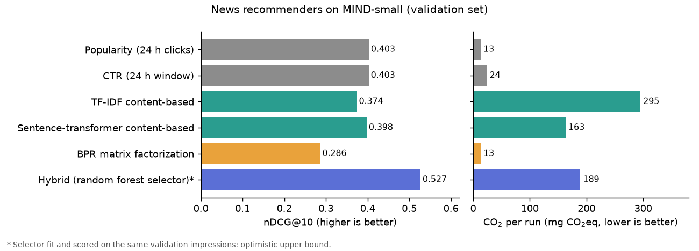

# News Recommender System

Comparison of news recommenders on the Microsoft News Dataset (MIND-small): popularity and CTR baselines, content-based models (TF-IDF and sentence transformers), BPR matrix factorization, and a hybrid that picks the best base model per impression. Models are scored on ranking quality (AUC, MRR, nDCG) and on the CO2 they cost to run.



## Problem

Given a user's click history and a list of candidate articles (an *impression*), rank the candidates so that the articles the user actually clicked come first. Better rankings usually need heavier models, so the project also asks what each gain in ranking quality costs in energy.

## Data

[MIND](https://msnews.github.io/) is a large-scale news recommendation dataset collected from anonymized Microsoft News behavior logs. This project uses **MIND-small**, a 50,000-user sample: the training set to build user and article statistics and the validation set (about 73,000 impressions) for evaluation.

The dataset is **not redistributed** in this repository. It is free for research use under the [Microsoft Research License Terms](https://github.com/msnews/MIND/blob/master/MSR%20License_Data.pdf), which apply to anyone who downloads it. Read and accept them on the [MIND page](https://msnews.github.io/) before downloading.

## Approach

| Model | Idea | Module |
|:--|:--|:--|
| Popularity | Rank by number of clicks in the last 24 h | `modeling/popularity_baseline.py` |
| CTR | Rank by clicks / impressions in a rolling window (12 h to one week) | `modeling/ctr_baseline.py` |
| TF-IDF content-based | Mean cosine similarity to the user's history over TF-IDF vectors of title, abstract and category | `modeling/content_based.py` |
| Sentence-transformer content-based | Same, with `all-MiniLM-L6-v2` embeddings | `modeling/content_based.py` |
| BPR | Matrix factorization with Bayesian Personalized Ranking on implicit click feedback (cornac) | `modeling/bpr.py` |
| Hybrid | A classifier (decision tree, random forest, logistic regression, kNN, LightGBM, neural network) predicts which of popularity, content-based or BPR ranks an impression best, from features such as hour, history length and candidate count | `modeling/hybrid.py` |

Predictions are rank lists per impression, scored with the MIND metrics in `evaluation.py`. CO2 is measured with [CodeCarbon](https://github.com/mlco2/codecarbon).

## Results

Validation set of MIND-small, recorded metrics in `reports/results.csv`:

| Model | AUC | MRR | nDCG@5 | nDCG@10 | CO2 (mg CO2eq) |
|:--|:-:|:-:|:-:|:-:|:-:|
| Popularity (24 h clicks) | 0.651 | 0.312 | 0.341 | 0.403 | 13 |
| CTR (24 h window) | 0.650 | 0.312 | 0.341 | 0.403 | 24 |
| TF-IDF content-based | 0.611 | 0.290 | 0.313 | 0.374 | 295 |
| Sentence-transformer content-based | 0.639 | 0.311 | 0.339 | 0.398 | 163 |
| BPR matrix factorization | 0.501 | 0.219 | 0.224 | 0.286 | 13 |
| Hybrid (random forest selector)* | 0.786 | 0.420 | 0.469 | 0.527 | 189 |

\* The selector is fit and scored on the same validation impressions, with labels derived from the validation clicks, so this row is an optimistic upper bound, not a held-out result. Other selectors (AUC): decision tree 0.790, kNN 0.702, LightGBM 0.670, neural network 0.663, logistic regression 0.651; see `reports/metrics/`.

- The simple popularity and CTR baselines are hard to beat: neither content-based model improves on them, and the CTR window length (12 h to one week) changes AUC by less than 0.001.
- The content-based models emit roughly 7 to 23 times more CO2 than the baselines without improving ranking quality here; the sentence-transformer model beats TF-IDF at about half the emissions.
- BPR is close to chance level (AUC 0.501) in the recorded run.
- The hybrid CO2 is the sum of its three base models and excludes fitting the selector.
- CO2 figures come from single CodeCarbon runs on laptop CPUs, with different hardware and grid regions across runs, so small differences between the cheap models are within noise.

## How to run

Python 3.10 to 3.12.

```bash
python -m venv .venv && source .venv/bin/activate
pip install -e ".[dev,plots]"               # core, tests, figure
pip install -e ".[content,bpr,hybrid]"      # optional: model-specific dependencies
```

Download MIND-small as described above and unpack the training set into `data/raw/train/` and the validation set into `data/raw/validation/`, so that both folders contain `behaviors.tsv` and `news.tsv`.

```bash
python -m news_recommender_system prepare-data     # TSV -> data/interim/*.parquet
python -m news_recommender_system truth            # data/truth/truth_val.txt

python -m news_recommender_system popularity       # predictions/popularity.txt
python -m news_recommender_system ctr --window-hours 24
python -m news_recommender_system content --method tfidf
python -m news_recommender_system content --method sbert
python -m news_recommender_system bpr
python -m news_recommender_system hybrid           # needs popularity, sbert and bpr predictions

python -m news_recommender_system evaluate popularity   # reports/metrics/scores_val_popularity.txt
python -m news_recommender_system plot                  # reports/figures/results.png
```

Add `--track-carbon` to any model command to measure its emissions with CodeCarbon (reports are written to `reports/emissions/`). The content-based models build a dense article similarity matrix and need about 16 GB of RAM.

Tests and lint need no dataset:

```bash
pytest
ruff check . && ruff format --check .
```

`notebooks/results_overview.ipynb` reads the saved metrics and shows the comparison.

## Project structure

```
.
├── news_recommender_system/
│   ├── cli.py                  command line interface (python -m news_recommender_system)
│   ├── config.py               paths and MIND file formats
│   ├── data.py                 raw TSV -> time-sorted Parquet
│   ├── truth.py                ground-truth label files
│   ├── evaluation.py           AUC, MRR, nDCG@k and scoring of prediction files
│   ├── carbon_tracking.py      CodeCarbon wrapper
│   ├── plots.py                results figure
│   └── modeling/
│       ├── ranking.py          shared helpers for prediction files
│       ├── popularity_baseline.py
│       ├── ctr_baseline.py
│       ├── content_based.py    TF-IDF and sentence-transformer models
│       ├── bpr.py
│       └── hybrid.py           best-model labels, selector features, classifiers
├── notebooks/results_overview.ipynb
├── reports/
│   ├── results.csv             summary table used for the figure
│   ├── metrics/                saved validation scores per model
│   └── figures/results.png
├── tests/                      metric and baseline tests on synthetic data
└── .github/workflows/ci.yml    ruff and pytest
```

## Limitations

- The hybrid scores are not a held-out estimate (see the table note); a fair evaluation needs the selector trained and tested on separate impressions.
- Evaluation uses only the MIND-small validation split, a single run per model and no hyperparameter tuning.
- The content-based models take the click history from one impression per user in the validation data (first for TF-IDF, last for sentence transformers) and compute article similarity over the validation articles only.
- BPR is trained on the training clicks only and does not handle new users or articles.
- CO2 measurements are single runs on different machines and regions; treat them as indicative.
- MIND is an English-language dataset from one platform, so the results may not carry over to other news sites or languages.

## License

MIT, see [LICENSE](LICENSE). MIND is subject to its own license terms.
